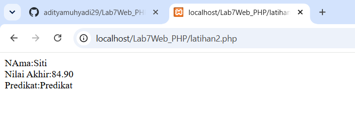

# Lab7Web_PHP
Belajar PHP dasar

1. Menjalankan PHP

Membuat halaman PHP sederhana untuk menampilkan teks dan waktu server menggunakan fungsi date().

## Result

2. Variabel, Operator, dan Percabangan

Menggunakan variabel untuk menyimpan nilai mahasiswa, menghitung nilai akhir berdasarkan bobot tugas, UTS, dan UAS, serta menentukan predikat berdasarkan hasil perhitungan.

## Result

3. Perulangan dan Array

Membuat array yang berisi nama mahasiswa dan menampilkan seluruh data menggunakan perulangan foreach.

## Result

