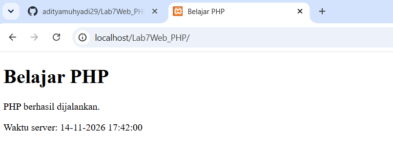
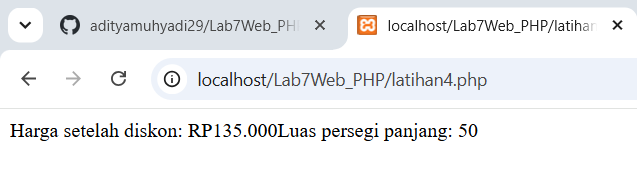
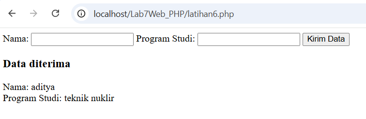
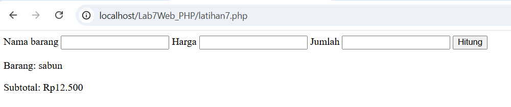
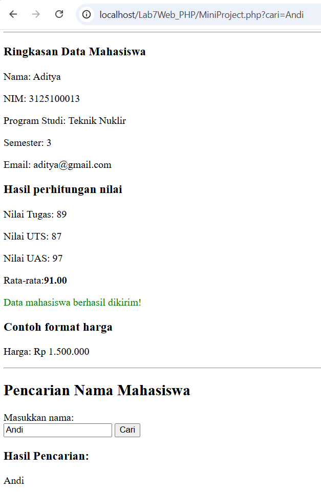

# Lab7Web_PHP
Belajar PHP dasar

1. Menjalankan PHP

Membuat halaman PHP sederhana untuk menampilkan teks dan waktu server menggunakan fungsi date().

## Result

2. Variabel, Operator, dan Percabangan

Menggunakan variabel untuk menyimpan nilai mahasiswa, menghitung nilai akhir berdasarkan bobot tugas, UTS, dan UAS, serta menentukan predikat berdasarkan hasil perhitungan.

## Result

3. Perulangan dan Array

Membuat array yang berisi nama mahasiswa dan menampilkan seluruh data menggunakan perulangan foreach.

## Result

4. Membuat Function

Membuat function hitungDiskon() untuk menghitung harga setelah mendapatkan potongan diskon. Latihan juga mencakup pembuatan function tambahan.

## Result

5. Memproses Form dengan GET

Membuat formulir pencarian sederhana menggunakan metode GET untuk menerima dan menampilkan kata kunci yang dimasukkan pengguna.

## Result

6. Memproses Form dengan POST

Membuat formulir untuk menerima nama dan program studi mahasiswa menggunakan metode POST, kemudian menampilkan data setelah dikirim.

## Result

7. Pengolahan Data Sederhana

Membuat formulir transaksi barang yang menerima nama barang, harga, dan jumlah. PHP menghitung subtotal berdasarkan harga dikalikan jumlah barang serta melakukan validasi input.

## Result 

# Mini Project
Mini project ini merupakan aplikasi sederhana untuk memasukkan dan menampilkan data mahasiswa menggunakan PHP.

Fitur aplikasi:

Form input nama mahasiswa.

Form input NIM.

Form input program studi.

Form input semester.

Form input email.

Pengiriman data menggunakan metode POST.

Validasi kolom wajib diisi.

Validasi semester berupa bilangan bulat dengan rentang 1–14.

Validasi format email menggunakan FILTER_VALIDATE_EMAIL.

Menampilkan pesan kesalahan jika input tidak valid.

Menampilkan ringkasan data mahasiswa jika seluruh input valid.

Menggunakan htmlspecialchars() untuk mengamankan output dari input pengguna.

# Cara Menjalankan Program

Pastikan XAMPP atau Laragon sudah terinstal.

Jalankan layanan Apache melalui XAMPP/Laragon.

Simpan folder proyek lab7_php ke dalam direktori web server:

XAMPP: C:/xampp/htdocs/lab7_php/

Laragon: C:/laragon/www/lab7_php/

Buka folder proyek menggunakan Visual Studio Code.

Pastikan file PHP sudah tersimpan di dalam folder proyek.

Buka browser.

Akses alamat berikut:

http://localhost/lab7_php/

Jalankan dan uji setiap latihan melalui browser.

## Result

# Pengujian

Pengujian dilakukan dengan mencoba berbagai jenis input untuk memastikan program berjalan sesuai tujuan.

Beberapa pengujian yang dilakukan:

Memastikan PHP berhasil dijalankan melalui localhost.

Mengubah nilai tugas, UTS, dan UAS untuk menguji perhitungan nilai akhir.

Menambahkan nama mahasiswa ke dalam array.

Menguji function perhitungan diskon.

Mengirim kata kunci menggunakan metode GET.

Mengirim data mahasiswa menggunakan metode POST.

Menguji pengolahan transaksi dengan harga desimal dan jumlah barang.

Menguji validasi formulir data mahasiswa dengan input valid dan tidak valid.

Menguji input karakter khusus seperti tanda kutip dan tag HTML.

# Kesimpulan

Melalui Praktikum 7, mahasiswa dapat memahami dasar-dasar pemrograman PHP dan penerapannya dalam pengembangan aplikasi web sederhana. Materi yang dipelajari meliputi variabel, operator, percabangan, perulangan, array, function, serta pengolahan formulir menggunakan GET dan POST.

Mini project formulir data mahasiswa memberikan pemahaman mengenai proses penerimaan data, validasi input di sisi server, dan penampilan kembali data secara aman menggunakan htmlspecialchars().