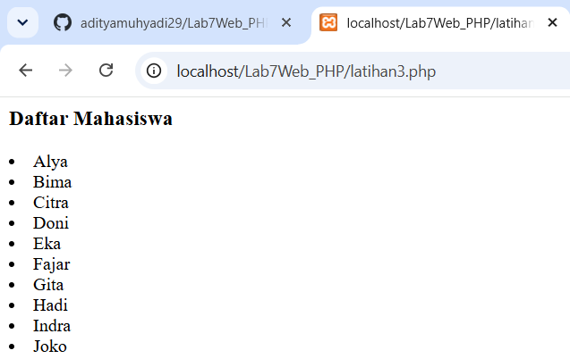
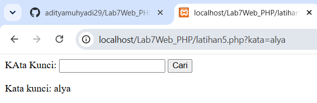
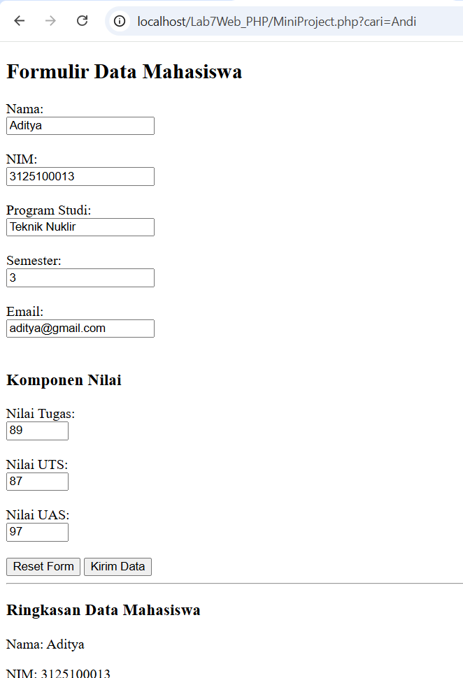

# Lab7Web_PHP
Belajar PHP dasar

1. Menjalankan PHP

Membuat halaman PHP sederhana untuk menampilkan teks dan waktu server menggunakan fungsi date().

## Result


2. Variabel, Operator, dan Percabangan

Menggunakan variabel untuk menyimpan nilai mahasiswa, menghitung nilai akhir berdasarkan bobot tugas, UTS, dan UAS, serta menentukan predikat berdasarkan hasil perhitungan.

## Result


3. Perulangan dan Array

Membuat array yang berisi nama mahasiswa dan menampilkan seluruh data menggunakan perulangan foreach.

## Result



4. Membuat Function

Membuat function hitungDiskon() untuk menghitung harga setelah mendapatkan potongan diskon. Latihan juga mencakup pembuatan function tambahan.

## Result


5. Memproses Form dengan GET

Membuat formulir pencarian sederhana menggunakan metode GET untuk menerima dan menampilkan kata kunci yang dimasukkan pengguna.

## Result



6. Memproses Form dengan POST

Membuat formulir untuk menerima nama dan program studi mahasiswa menggunakan metode POST, kemudian menampilkan data setelah dikirim.

## Result


7. Pengolahan Data Sederhana

Membuat formulir transaksi barang yang menerima nama barang, harga, dan jumlah. PHP menghitung subtotal berdasarkan harga dikalikan jumlah barang serta melakukan validasi input.

## Result 


# Mini Project
Mini project ini merupakan aplikasi sederhana untuk memasukkan dan menampilkan data mahasiswa menggunakan PHP.

Fitur aplikasi:

Form input nama mahasiswa.

Form input NIM.

Form input program studi.

Form input semester.

Form input email.

Pengiriman data menggunakan metode POST.

Validasi kolom wajib diisi.

Validasi semester berupa bilangan bulat dengan rentang 1–14.

Validasi format email menggunakan FILTER_VALIDATE_EMAIL.

Menampilkan pesan kesalahan jika input tidak valid.

Menampilkan ringkasan data mahasiswa jika seluruh input valid.

Menggunakan htmlspecialchars() untuk mengamankan output dari input pengguna.

# Cara Menjalankan Program

Pastikan XAMPP atau Laragon sudah terinstal.

Jalankan layanan Apache melalui XAMPP/Laragon.

Simpan folder proyek lab7_php ke dalam direktori web server:

XAMPP: C:/xampp/htdocs/lab7_php/

Laragon: C:/laragon/www/lab7_php/

Buka folder proyek menggunakan Visual Studio Code.

Pastikan file PHP sudah tersimpan di dalam folder proyek.

Buka browser.

Akses alamat berikut:

http://localhost/lab7_php/

Jalankan dan uji setiap latihan melalui browser.

## Result




# Pengujian

Pengujian dilakukan dengan mencoba berbagai jenis input untuk memastikan program berjalan sesuai tujuan.

Beberapa pengujian yang dilakukan:

Memastikan PHP berhasil dijalankan melalui localhost.

Mengubah nilai tugas, UTS, dan UAS untuk menguji perhitungan nilai akhir.

Menambahkan nama mahasiswa ke dalam array.

Menguji function perhitungan diskon.

Mengirim kata kunci menggunakan metode GET.

Mengirim data mahasiswa menggunakan metode POST.

Menguji pengolahan transaksi dengan harga desimal dan jumlah barang.

Menguji validasi formulir data mahasiswa dengan input valid dan tidak valid.

Menguji input karakter khusus seperti tanda kutip dan tag HTML.

# Kesimpulan

Melalui Praktikum 7, mahasiswa dapat memahami dasar-dasar pemrograman PHP dan penerapannya dalam pengembangan aplikasi web sederhana. Materi yang dipelajari meliputi variabel, operator, percabangan, perulangan, array, function, serta pengolahan formulir menggunakan GET dan POST.

Mini project formulir data mahasiswa memberikan pemahaman mengenai proses penerimaan data, validasi input di sisi server, dan penampilan kembali data secara aman menggunakan htmlspecialchars().

# Pertanyaan & Pembahasan

### 1. Apa perbedaan pemrosesan client-side dan server-side?

- **Client-side** adalah pemrosesan yang dilakukan di sisi pengguna melalui browser. Contohnya menggunakan HTML, CSS, dan JavaScript untuk mengatur tampilan halaman serta melakukan validasi input sederhana.
- **Server-side** adalah pemrosesan yang dilakukan di sisi server. Contohnya menggunakan PHP untuk mengolah data, melakukan perhitungan, memvalidasi input, dan berkomunikasi dengan database.

Jadi, perbedaannya terletak pada tempat proses dijalankan. Client-side berjalan di browser, sedangkan server-side berjalan di server.

### 2. Mengapa file PHP harus dijalankan melalui web server?

File PHP harus dijalankan melalui web server karena PHP merupakan bahasa pemrograman server-side yang membutuhkan lingkungan server untuk menerjemahkan dan menjalankan kode programnya.

Web server seperti Apache akan memproses kode PHP terlebih dahulu, kemudian mengirimkan hasilnya dalam bentuk HTML ke browser. Jika file PHP dibuka langsung dengan klik dua kali, kode PHP tidak dapat diproses sebagaimana mestinya.

### 3. Apa fungsi tanda $ pada variabel PHP?

Tanda `$` digunakan sebagai penanda untuk mendeklarasikan dan mengakses variabel dalam PHP.

Variabel berfungsi untuk menyimpan data yang dapat digunakan dan diolah kembali selama program berjalan.

Contoh:

```php
$nama = "Siti";
$umur = 20;

echo $nama;
echo $umur;
```

Pada contoh tersebut, `$nama` menyimpan data berupa teks, sedangkan `$umur` menyimpan data berupa angka.

### 4. Apa perbedaan metode GET dan POST?

GET dan POST merupakan metode HTTP yang digunakan untuk mengirimkan data dari browser ke server.

- **GET** mengirimkan data melalui URL sehingga data yang dikirim dapat terlihat pada alamat browser. Metode ini biasanya digunakan untuk pencarian atau mengambil data.
- **POST** mengirimkan data melalui bagian body request sehingga data tidak ditampilkan langsung pada URL. Metode ini biasanya digunakan untuk mengirim formulir, memasukkan data, atau mengubah data.

Contohnya, GET digunakan untuk mencari kata kunci, sedangkan POST digunakan untuk mengirim nama dan program studi mahasiswa.

### 5. Mengapa input pengguna perlu divalidasi di sisi server?

Input pengguna perlu divalidasi di sisi server untuk memastikan bahwa data yang diterima sesuai dengan ketentuan program dan tidak mengandung data yang tidak valid.

Validasi di sisi browser saja tidak cukup karena dapat dilewati atau dimanipulasi oleh pengguna. Oleh karena itu, server harus melakukan pemeriksaan ulang terhadap data yang dikirim.

Contohnya, memeriksa apakah email memiliki format yang benar, kolom wajib sudah diisi, dan semester berada dalam rentang 1 sampai 14.

### 6. Apa fungsi htmlspecialchars() ketika menampilkan data dari form?

Fungsi `htmlspecialchars()` digunakan untuk mengubah karakter khusus HTML menjadi bentuk entitas HTML sehingga karakter tersebut ditampilkan sebagai teks dan tidak ditafsirkan sebagai kode HTML.

Fungsi ini membantu mencegah serangan XSS (*Cross-Site Scripting*) ketika menampilkan data yang berasal dari input pengguna.

Contoh:

```php
$nama = "<script>alert('Hello');</script>";

echo htmlspecialchars($nama, ENT_QUOTES, "UTF-8");
```

Dengan menggunakan fungsi tersebut, tag script akan ditampilkan sebagai teks biasa dan tidak dijalankan oleh browser.

### 7. Apa manfaat penggunaan function dalam program PHP?

Function bermanfaat untuk membuat program menjadi lebih terstruktur, rapi, dan mudah dikelola. Dengan function, suatu kumpulan perintah dapat digunakan kembali tanpa harus menuliskan kode yang sama berulang kali.

Manfaat penggunaan function antara lain:

1. Mengurangi pengulangan kode program.
2. Mempermudah proses pemeliharaan dan perbaikan program.
3. Membuat kode lebih terstruktur dan mudah dibaca.
4. Memudahkan pengujian setiap bagian program.
5. Memungkinkan penggunaan kembali kode untuk berbagai kebutuhan.

Contohnya, function `hitungDiskon()` dapat digunakan untuk menghitung harga setelah diskon tanpa harus menulis ulang rumus perhitungan setiap kali dibutuhkan.

---

## Kesimpulan

Berdasarkan pertanyaan dan pembahasan di atas, dapat disimpulkan bahwa PHP merupakan bahasa pemrograman server-side yang digunakan untuk mengolah data pada web server.

Dalam pengembangan aplikasi web, pemahaman mengenai client-side dan server-side, variabel, metode GET dan POST, validasi input, keamanan output, serta penggunaan function sangat penting untuk menghasilkan program yang terstruktur, aman, dan mudah dikembangkan.

---
